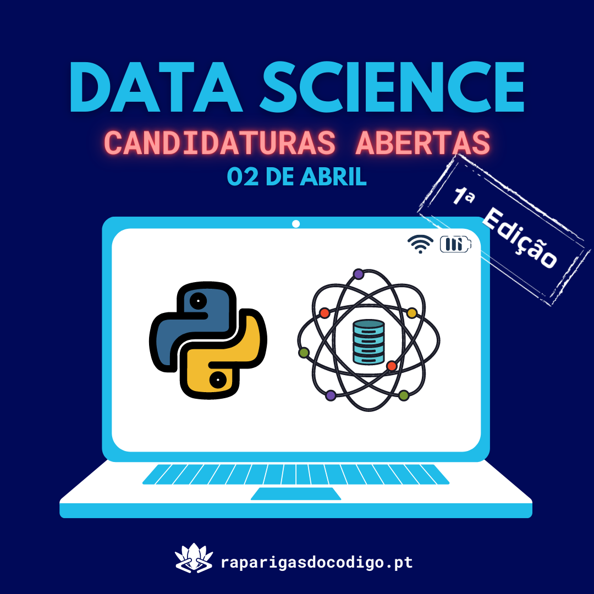

# Python para Data Science - Edição 1

---
## 👋 Informação Geral

Esta segunda edição de workshops de Python terá duração de 7 semanas, de **2 Abril a 14 de Maio 2022**.

As sessões serão todos os Sábados das **10h às 12h** (2h) e feitos via Zoom.

#### Formato:
Os workshops desenvolvem-se numa perspectiva teórico-prática: em cada sessão são apresentados os conceitos associados a cada tema (exemplificados com pequenos excertos de código) e promovida a resolução de casos práticos e problemas reais.

#### Equipa de instrutores:

- [Catarina Silva](https://www.linkedin.com/in/catarina-ns-silva/)
- [José Amorim](https://www.linkedin.com/in/josepamorim/)
- [Miriam Santos](https://www.linkedin.com/in/miriamseoanesantos/)
- [Ricardo Pereira](https://ricardodcpereira.com/)
- [Rita Pereira](https://www.linkedin.com/in/ritasousapereira/)

#### Pré-Requisitos
Domínio básico da linguagem Python.

---
## 📅 Planeamento

| Sessão | Data  | Tópicos |
| ------ |  ----- | -----------------|
| [S00](/S00-Sessão-Abertura) | 2 de Abril | Introdução à Ciência de Dados.   Sessão de Abertura   Introdução ao Jupyter Notebook| 
| S01 | 9 de Abril | Análise Exploratória de Dados: Parte 1.  Leitura de dados a partir de ficheiros CSV.   Biblioteca Pandas.|
| [S02](/S02-Exploração-Dados-numpy-matplotlib) | 16 de Abril | Análise Exploratória de Dados: Parte 2.  Bibliotecas NumPy e SciPy.   Visualização de dados.   Biblioteca Matplotlib.|
| S03 | 23 de Abril  | Pré-Processamentos de Dados.   Discretização e normalização de variáveis. Dados em falta e dados desequilibrados.|
| S04 | 30 de Abril | Construção e Avaliação de Modelo: parte 1    Aprendizagem automática. Modelos supervisionados.  Regressão linear. Medidas de erro: MAE, MSE e RMSE.|
| S05 | 7 de Maio | Construção e Avaliação de Modelo: parte 2   Classificação. Regressão Logística. Métricas de classificação: matriz de confusão.|
| S06 | 14 de Maio | Sessão de Encerramento.   Carreiras e Oportunidades em Ciência de Dados. Projetos para Iniciantes.|

---
## 📚 Bibliografia

<b>Livros de referência: </b>  
- [Data Science from Scratch: First Principles with Python, 2nd Edition, O'Reilly, 2019](https://github.com/As-Raparigas-do-Codigo/Introduction-Data-Science-Python/blob/main/books/Grus%2C%20Joel%20-%20Data%20Science%20from%20Scratch_%20First%20Principles%20with%20Python%20(2015%2C%20O'Reilly%20Media)%20-%20libgen.li.pdf)</b>
- [Python Data Science Handbook: Essential Tools for Working with Data, O'Reilly, 2016](https://github.com/As-Raparigas-do-Codigo/Introduction-Data-Science-Python/blob/main/books/Jake%20VanderPlas%20-%20Python%20Data%20Science%20Handbook.%20%20Essential%20Tools%20for%20Working%20with%20Data%20(2016%2C%20O'Reilly%20Media)%20-%20libgen.lc.pdf) </b>
- [Data Science, The MIT Press Essential Knowledge series, 2018](https://github.com/As-Raparigas-do-Codigo/Introduction-Data-Science-Python/blob/main/books/MIT%20Press%20essential%20knowledge%20series%20Kelleher%2C%20John%20D._Tierney%2C%20Brendan%20-%20Data%20science%20(2018%2C%20The%20MIT%20Press)%20-%20libgen.lc.pdf)

