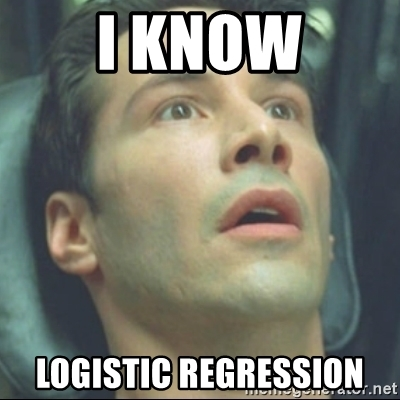

# 📊 S05 - Construção e Avaliação de Modelos: parte 2

Bem vinda à sexta aula de Python para Data Science! 🥳

## 📖 Agenda da sessão:

- Classificação. 
- Regressão logística. 
- Métricas de classificação: matriz de confusão, *accuracy*, *precision*, *recall* e *f1-score*.
- Exemplos com o k-Nearest Neighbors e outros classificadores.

## 📚 Material:

- Ficheiro > Abrir como cópia o colab:
[Google colab para a aula de hoje](https://colab.research.google.com/drive/1I4GxS9rvZopUVuOcP8g2bk4LUWbEKu4C?usp=sharing)
🚀

## Lembrete para TPC: 🛳  Projeto - O Desastre do Titanic 
Durante o curso, iremos desenvolver um projeto de *data science* passando por várias fases desde a exploração dos dados até ao desenvolvimento de modelos de previsão (classificação e regressão). A cada aula, irás explorar cada uma das componentes do processo de CRISP-DM, começando hoje pela exploração do domínio do problema (*Business and Data Understanding*).

O dataset que irás estudar é o "Titanic", um dos problemas mais utilizados para iniciantes em Data Science. Podes aceder ao dataset [aqui](https://www.kaggle.com/competitions/titanic/data).

**Lê o dataset para o um notebook e utiliza esse mesmo colab para as próximas semanas 🏗 Como?**

1. Faz download do train data set no link da competição do kaggle em cima
2. Segue os passos tal como fizémos na aula! download do csv do kaggle 👉 import para o colab 😜

👉 **Perguntas para esta semana:**

Aplicar todas as técnicas de pré-processamento de dados estudadas ao dataset.

## ⁉️ Dúvidas e Questões:
Se tiveres alguma dúvida sobre as sessões ou o projeto, podes:

- Contactar o teu mentor ou mentora directamente, através do canal de mentorias no nosso discord;
- Colocar a tua dúvida no discord, no canal `#data-science-geral` e qualquer um dos mentores ou colegas te poderá ajudar;
- Colocar as tuas dúvidas ou comentários directamente nas discussões associadas a este repositório do GitHub, [aqui!](https://github.com/As-Raparigas-do-Codigo/python-data-science-ed-1/discussions)

## 🛠 Documentação/Ajuda:

The Hundred-Page Machine Learning Book by Andriy Burkov: https://themlbook.com/

Scikit-learn (Tools for predictive data analysis, built on NumPy, SciPy, and matplotlib): https://scikit-learn.org/

[Programmer's best friend - Stack Overflow](https://stackoverflow.com/)
